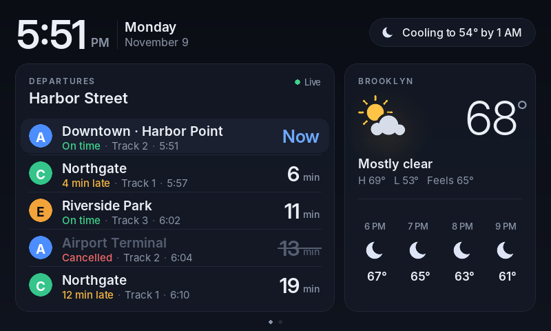

# Train & Weather Dashboard

A glanceable departures + weather display for a Raspberry Pi Zero W and an
800×480 touchscreen (built for the Elecrow 5" HDMI panel).


| Rain on the way | Delays & cancellations |
|---|---|
|  |  |
| **Night** | **7-day forecast** (tap to switch) |
|  |  |

## Why it's built this way

The original Pi Zero W (ARMv6, 512 MB) can't run a modern Chromium kiosk, so
this is a small Python + pygame program that draws directly to the screen —
no desktop, no browser. It uses ~40 MB of RAM, and only redraws when the
minute ticks or new data arrives.

- **Weather:** [Open-Meteo](https://open-meteo.com) — free, no API key.
- **Trains:** pluggable providers in `sources/trains/`:
  - `mock` — realistic fake data (default; great for designing)
  - `gtfs_rt` — any agency publishing a GTFS-realtime TripUpdates feed
  - `transport_rest` — transport.rest / HAFAS APIs (Germany, much of Europe)
  - Adding another API = one file with a `fetch(cfg) -> list[Departure]` function.

## Develop on your laptop

```bash
pip install pygame requests
python3 dashboard.py --mock                    # 800×480 window, fake data
python3 dashboard.py --mock --scenario delays  # also: rain, night, snow
```

`layout.py`, `theme.py` and `icons.py` **hot-reload on save** — keep the
window open and tweak the design live. A layout bug shows an error screen
instead of crashing; fix it and save again.

Keys: `←`/`→` or click switches page · `R` refreshes data · `Q` quits.

Render PNGs without a screen (used for the images above):

```bash
python3 tools/render.py                 # every scenario → docs/screenshots/
python3 tools/render.py --scenario rain --page 1 --scale 2 --out /tmp/x.png
```

## Set up the Pi

1. Flash **Raspberry Pi OS Lite (32-bit)** with Raspberry Pi Imager; set
   Wi-Fi, hostname (`pizero`) and SSH in the Imager settings.
2. Add the screen settings from [`deploy/config.txt.snippet`](deploy/config.txt.snippet)
   to `/boot/firmware/config.txt` and reboot. (Touch needs a soldered GPIO
   header on a non-"WH" Zero W.)
3. Copy the project over and install:

   ```bash
   rsync -az --exclude .git ./ pi@pizero.local:~/train-weather-dashboard/
   ssh pi@pizero.local 'cd ~/train-weather-dashboard && bash deploy/install.sh'
   ```

4. Edit `~/train-weather-dashboard/config.toml` on the Pi (location, station,
   provider), then `sudo systemctl restart dashboard`.

For the `gtfs_rt` provider also run on the Pi:
`sudo apt install python3-pip && pip install --break-system-packages --no-deps gtfs-realtime-bindings`

## Iterate on the real screen

```bash
PI=pi@pizero.local ./sync.sh
```

Pushes every save to the Pi. Layout/theme/icon changes appear on the screen
within a second without restarting; other changes restart the service
automatically.

Grab what the Pi is showing:

```bash
ssh pi@pizero.local 'pkill -USR1 -f "python3 .*dashboard.py"; sleep 1' && scp pi@pizero.local:/tmp/dashboard.png .
```

Logs: `ssh pi@pizero.local journalctl -u dashboard -f`

## Project layout

```
dashboard.py        main loop: display, touch, background fetching, hot reload
layout.py           everything drawn on screen            (hot-reloaded)
theme.py            colours, fonts, spacing               (hot-reloaded)
icons.py            weather icons drawn in code           (hot-reloaded)
sources/            weather + train providers, mock data
tools/render.py     headless PNG renderer
deploy/             systemd unit, installer, display config
sync.sh             watch & push to the Pi
config.example.toml copy to config.toml
```

Fonts: [Inter](https://github.com/rsms/inter), SIL Open Font License (see `assets/fonts/OFL.txt`).
