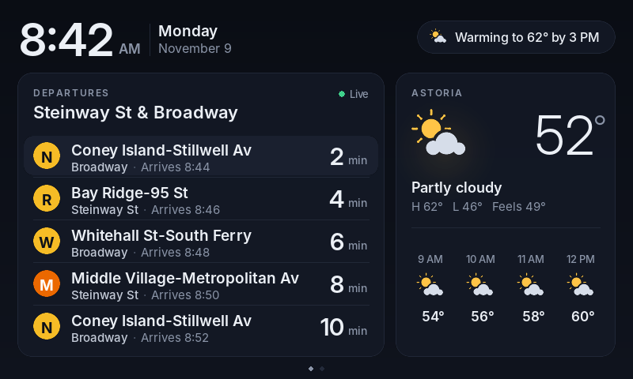
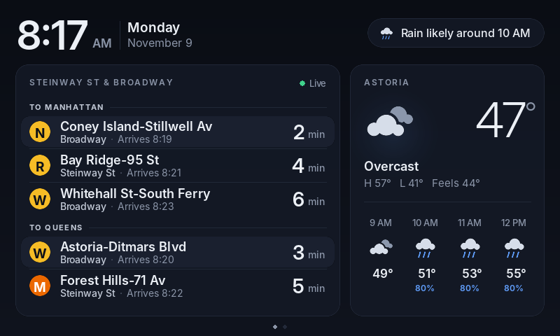
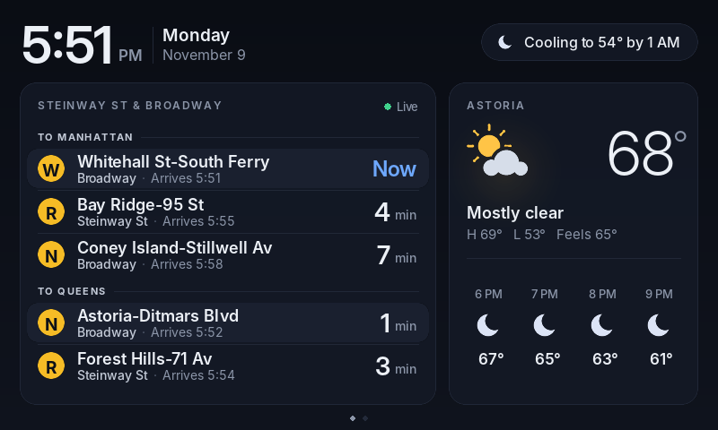
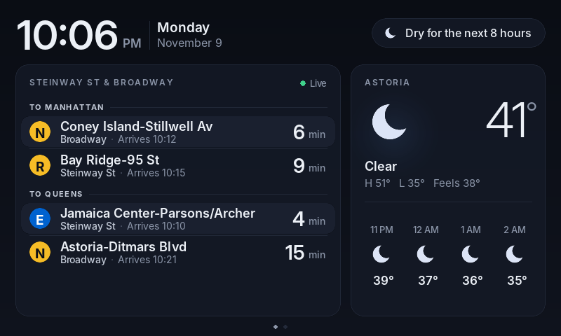
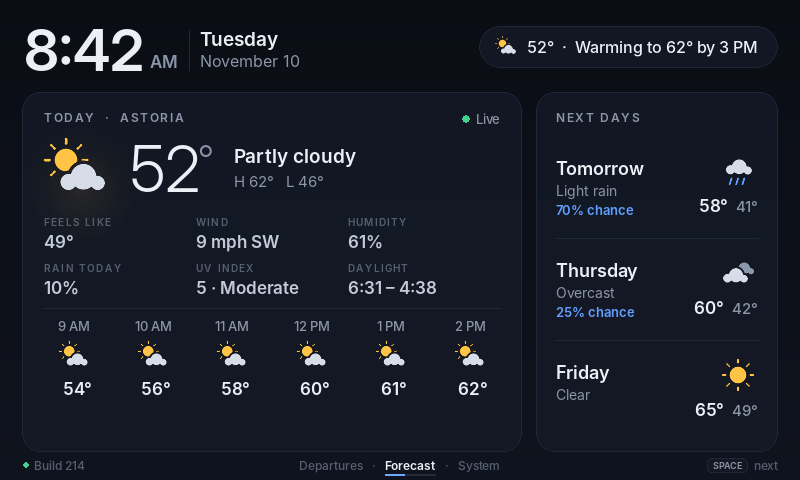
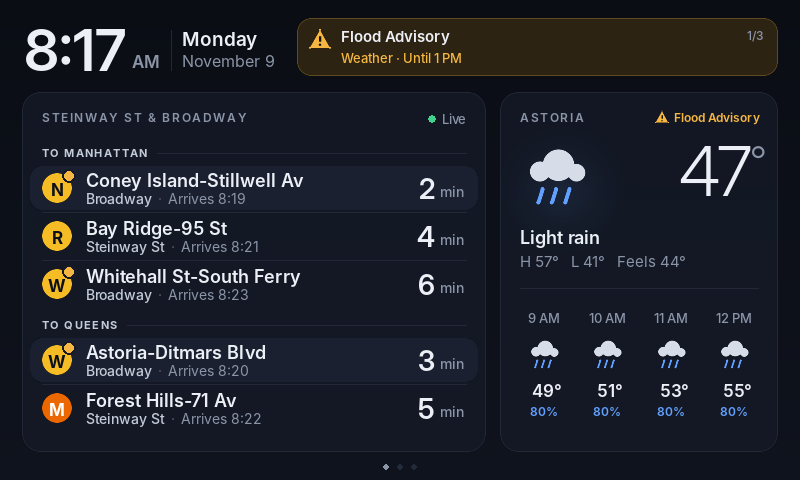
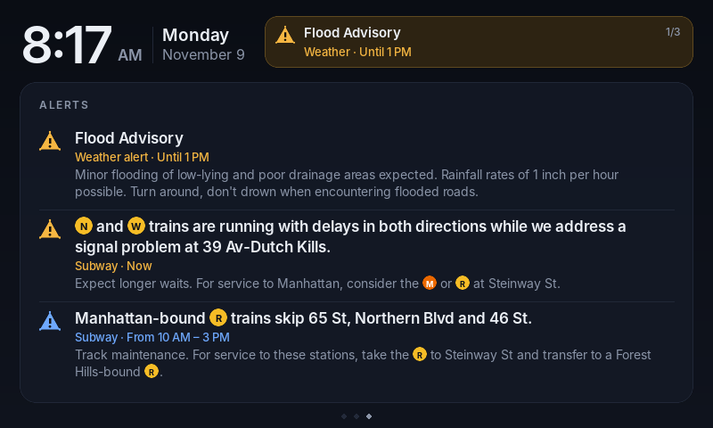
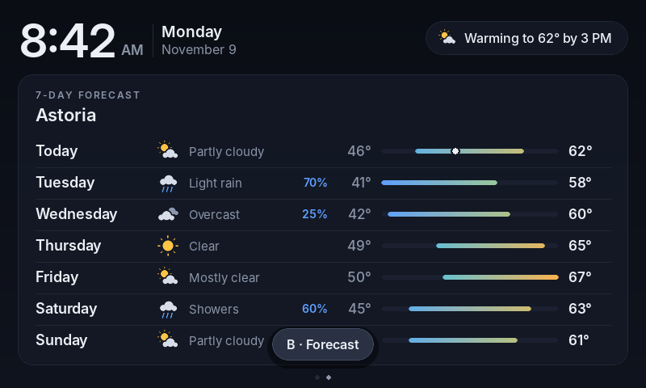
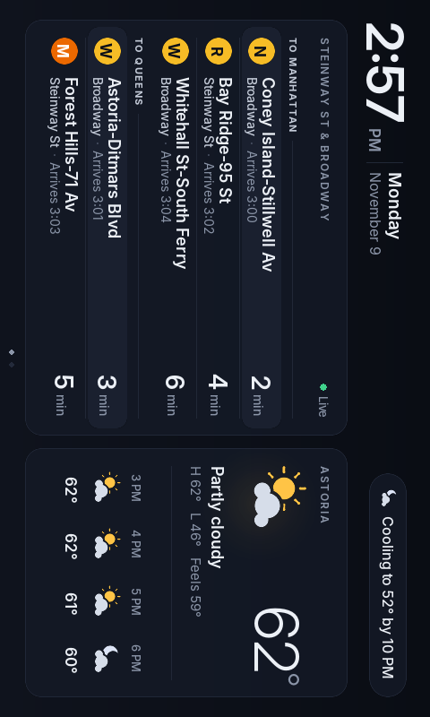

# Train & Weather Dashboard

A glanceable NYC Subway departures + weather display for a Raspberry Pi
Zero W and an 800×480 screen. Works with either:

- **Elecrow 5" HDMI touchscreen** — tap to switch pages, or
- **Pimoroni HyperPixel 4.0** (rectangular, non-touch) + **Button SHIM** for input.



| Rain on the way | Evening |
|---|---|
|  |  |
| **Night** | **7-day forecast** (tap to switch) |
|  |  |
| **Service & weather alerts** | **Alert details** (tap the banner) |
|  |  |

## Why it's built this way

The original Pi Zero W (ARMv6, 512 MB) can't run a modern Chromium kiosk, so
this is a small Python + pygame program that draws directly to the screen —
no desktop, no browser. It uses ~40 MB of RAM, and only redraws when the
minute ticks or new data arrives.

- **Subway:** the MTA's [GTFS-realtime feeds](https://www.mta.info/developers)
  — no API key. Only the feeds for lines that stop at your station are
  downloaded. Each train shows its line (◆ diamond = express), its real
  destination, and minutes until it arrives.
- **Weather:** [Open-Meteo](https://open-meteo.com) — free, no API key.
- **Alerts:** MTA service alerts (delays, suspensions, planned work) for the
  lines at your stations, and [National Weather Service](https://www.weather.gov/documentation/services-web-api)
  advisories/watches/warnings for your location — both free, no key.

### Alerts

When something is going on, a colour-coded banner takes over the top right
(red = severe weather, amber = current problem, blue = planned work starting
soon) and cycles through alerts every 8 s. Lines with a current problem get an
amber dot on their badge, and active weather alerts are flagged on the weather
card. Tap the banner for an **Alerts** page with the full details; that page
only exists while there are alerts. Planned work shows up to 12 hours before it
starts (`[alerts] upcoming_hours`).

## Configuration

**It works out of the box.** The defaults (in [`config.py`](config.py)) are:

| Setting | Default |
|---|---|
| Weather location | zip **11106** (Astoria) |
| Stations | **Steinway St** (M R) and **Broadway** (N W) |
| Directions | Grouped: **To Manhattan** first, then **To Queens** |
| Clock / units | 12-hour, °F |

To change anything, copy [`config.example.toml`](config.example.toml) to
`config.toml` and uncomment only the lines you want — everything else keeps
its default. For example:

```toml
[subway]
directions = ["S"]                                     # Manhattan-bound only
walk_minutes = { "Steinway St" = 7, "Broadway" = 4 }   # hide trains you can't catch
```

Stations can be names or ids. A name used by several stations
("Broadway") picks the one nearest your zip. To look one up:

```bash
python3 tools/find_station.py steinway
#  G19    Steinway St                          E F M R
```

A zip other than 11106 is looked up once online (Open-Meteo geocoding) and
cached; or set `latitude`/`longitude` directly.

`data/subway.json` (station names, the lines at each station, line colours)
is built from the MTA's static schedule. Refresh it occasionally with
`python3 tools/build_stations.py`.

## Develop on your laptop

Use **Python 3.11–3.13** (see [Troubleshooting](#troubleshooting) for why not
3.14 with plain `pygame`):

```bash
python3.13 -m venv .venv && source .venv/bin/activate
pip install -r requirements.txt
python3 dashboard.py --mock                    # 800×480 window, fake data
python3 dashboard.py --mock --scenario evening # also: rain, night, snow, alerts
```

### Run with real data

Leave off `--mock` and it uses the live feeds — the same ones the Pi uses:

```bash
python3 dashboard.py                           # live data, defaults (11106, Steinway St + Broadway)
python3 dashboard.py --config my-stop.toml     # live data, a different config file
python3 dashboard.py --fullscreen              # fill the screen instead of an 800×480 window
```

- **No API keys or sign-up.** MTA GTFS-realtime, Open-Meteo and the National
  Weather Service are all free and open. You just need an internet connection.
- **Pick your stops** by creating `config.toml` (see [Configuration](#configuration));
  it's read automatically from the project folder. Use
  `python3 tools/find_station.py <name>` to find station names/ids.
- **How fresh it is:** trains every 30 s (`[subway] refresh_seconds`), weather
  every 15 min (`[weather] refresh_minutes`), subway alerts every 2 min,
  weather alerts every 5 min. Press `R` to fetch everything now.
- **Is it live?** Each card shows a status dot: green **Live**, grey
  **Connecting** (first fetch in progress), amber **Offline · 3m ago** (last
  fetch failed, still showing the last good data) or red **Offline** (never
  got data). Failed fetches retry within a minute.
- **Errors are printed to the terminal**, one line per failed fetch, e.g.
  `[trains] ConnectionError: …` or `[location] ValueError: Couldn't find zip code …`.
- Weather alerts come from the US National Weather Service, so they only
  work for US locations; turn them off with `[alerts] weather = false`.
- The first run with a zip other than 11106 needs the network once to look up
  its coordinates (cached in `~/.cache/train-weather-dashboard/`).

`layout.py`, `theme.py` and `icons.py` **hot-reload on save** — keep the
window open and tweak the design live. A layout bug shows an error screen
instead of crashing; fix it and save again.

Keys: `←`/`→` or click switches page · `R` refreshes data · `Q` quits.

Render PNGs without a screen (used for the images above):

```bash
python3 tools/render.py                 # every scenario → docs/screenshots/
python3 tools/render.py --scenario rain --page 1 --scale 2 --out /tmp/x.png
```

## Set up the Pi

1. Flash **Raspberry Pi OS Lite (32-bit)** with Raspberry Pi Imager; set
   Wi-Fi, hostname (`pizero`) and SSH in the Imager settings.
2. Add your screen's settings to `/boot/firmware/config.txt` and reboot:
   [`deploy/config.txt.snippet`](deploy/config.txt.snippet) for the Elecrow
   (touch needs a soldered GPIO header on a non-"WH" Zero W), or
   [`deploy/hyperpixel4.config.txt.snippet`](deploy/hyperpixel4.config.txt.snippet)
   for the HyperPixel (see below).
3. Copy the project over and install:

   ```bash
   rsync -az --exclude .git ./ pi@pizero.local:~/train-weather-dashboard/
   ssh pi@pizero.local 'cd ~/train-weather-dashboard && bash deploy/install.sh'
   ```

4. That's it — it starts with the defaults above. To customise, create
   `~/train-weather-dashboard/config.toml` on the Pi, then
   `sudo systemctl restart dashboard`.

## Automatic updates (optional)

CI tests every push. Once the default branch passes, CI moves a `deploy`
branch to that commit, and a timer on the Pi pulls it within ~5 min. If the
new version crash-loops, the Pi rolls back on its own. This needs the Pi
folder to be a `git clone`. Then run `bash deploy/install.sh --auto-update`.
Trade-offs, alternatives and setup steps are in
[`docs/remote-updates.md`](docs/remote-updates.md).

## HyperPixel 4.0 + Button SHIM

The HyperPixel plugs straight onto the Pi Zero's GPIO header and uses almost
every pin, including the normal I2C pins — so the Button SHIM can't sit on
the header too. Wire it to the HyperPixel's spare 5-pin I2C header instead:

| Button SHIM | HyperPixel 5-pin header |
|---|---|
| 3V3 | 3V3 |
| GND | GND |
| SDA | BCM 10 |
| SCL | BCM 11 |

Then add [`deploy/hyperpixel4.config.txt.snippet`](deploy/hyperpixel4.config.txt.snippet)
to `/boot/firmware/config.txt` (instead of the Elecrow lines) and reboot.

- **Rotation is automatic.** The panel is natively 480×800 portrait; the
  dashboard detects that and turns its 800×480 layout to fit. If yours is
  upside down, set `[display] rotate = 270`.
- **Buttons** (change any of them under `[buttons]` in `config.toml`):

  | Button | Default action |
  |---|---|
  | A | Departures |
  | B | 7-day forecast |
  | C | Alerts (when there are any) |
  | D | Refresh now |
  | E | Sleep — screen and backlight off; any button wakes it |

  Other actions: `next_page`, `prev_page`, `next_alert`. Each press shows a
  brief confirmation on screen.
- **Status LED** on the SHIM: green = all good, amber = trouble on your lines
  or a weather alert, blue = planned work coming up, red = severe weather or
  the MTA feed is unreachable. Brightness: `[buttons] led_brightness`.
- The SHIM is found automatically on whichever I2C bus it's on
  (`[buttons] i2c_bus = "auto"`); the official `buttonshim` library isn't
  used because it only works on bus 1.

On a laptop, keys **1–5** act as buttons A–E, and `--portrait` opens a
480×800 window to preview the rotation.

| Button press confirmation | What's sent to the portrait panel |
|---|---|
|  |  |

## Iterate on the real screen

```bash
PI=pi@pizero.local ./sync.sh
```

Pushes every save to the Pi. Layout/theme/icon changes appear on the screen
within a second without restarting; other changes restart the service
automatically.

Grab what the Pi is showing:

```bash
ssh pi@pizero.local 'pkill -USR1 -f "python3 .*dashboard.py"; sleep 1' && scp pi@pizero.local:/tmp/dashboard.png .
```

Logs: `ssh pi@pizero.local journalctl -u dashboard -f`

## Troubleshooting

**`NotImplementedError: font module not available (ImportError: cannot import name 'Font' from partially initialized module 'pygame.font' …)`**

Your `pygame` was compiled from source without its font support. This happens
on **Python 3.14**: `pygame` 2.6.1 has no prebuilt wheel for it, so `pip`
builds it locally, and if `SDL2_ttf` isn't installed it silently skips the
font module. pygame's fallback for that case has a circular-import bug, so
anything that draws text fails. Fix it either way:

```bash
# Option A (recommended — same pygame as the Pi): use Python 3.13 or older
rm -rf .venv && python3.13 -m venv .venv && source .venv/bin/activate
pip install -r requirements.txt

# Option B: stay on 3.14 and use pygame-ce, a drop-in fork with 3.14 wheels
pip uninstall -y pygame && pip install pygame-ce
```

Check it worked: `python3 -c "import pygame.font; pygame.font.init(); print('ok')"`.

**Trains show "Can't reach the MTA · retrying"** — check your connection and
the terminal output; the MTA feeds occasionally time out and recover on the
next retry.

## Project layout

```
dashboard.py        main loop: display, touch, background fetching, hot reload
layout.py           everything drawn on screen            (hot-reloaded)
theme.py            colours, fonts, spacing               (hot-reloaded)
icons.py            weather icons drawn in code           (hot-reloaded)
config.py           settings + defaults (config.toml overrides)
sources/            Open-Meteo weather, MTA subway + alerts, NWS alerts, mock data
hardware/           Button SHIM driver, screen rotation/scaling + backlight
data/subway.json    station + line table built from the MTA static GTFS
tools/render.py     headless PNG renderer
tools/find_station.py   look up station ids
deploy/             systemd units, installer, auto-updater, display config
.github/workflows/  CI: tests + headless render, promotes green builds to `deploy`
sync.sh             watch & push to the Pi
config.example.toml every option, commented out
```

Fonts: [Inter](https://github.com/rsms/inter), SIL Open Font License (see `assets/fonts/OFL.txt`).
